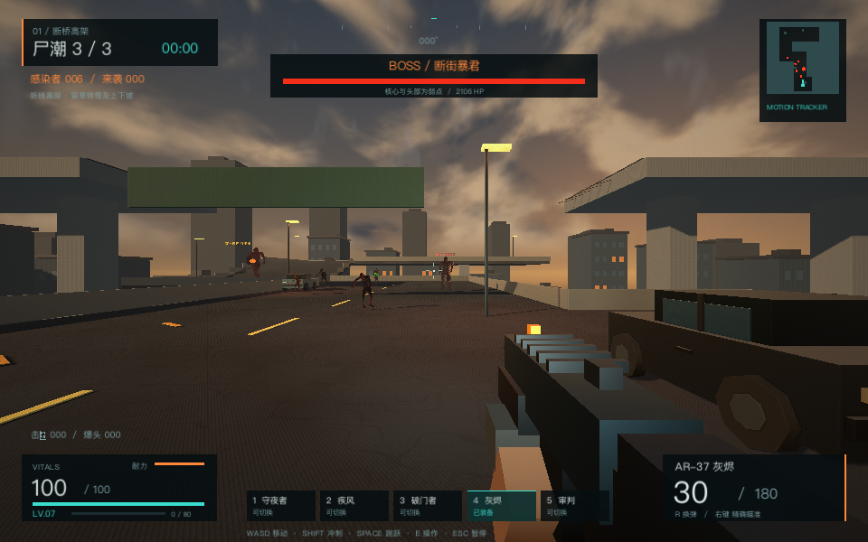
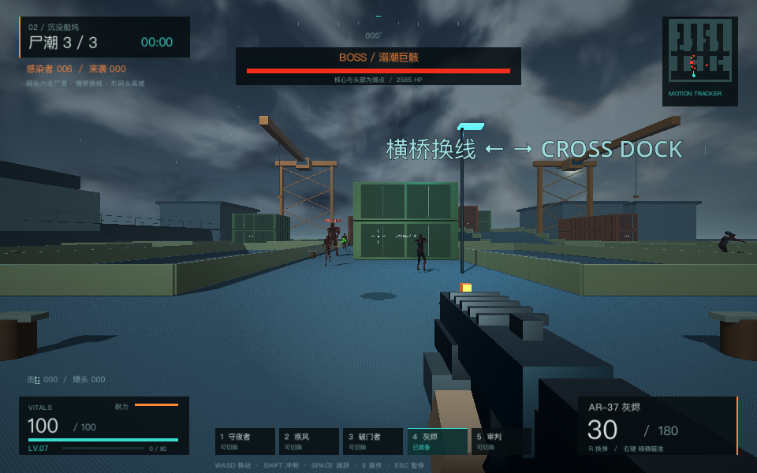
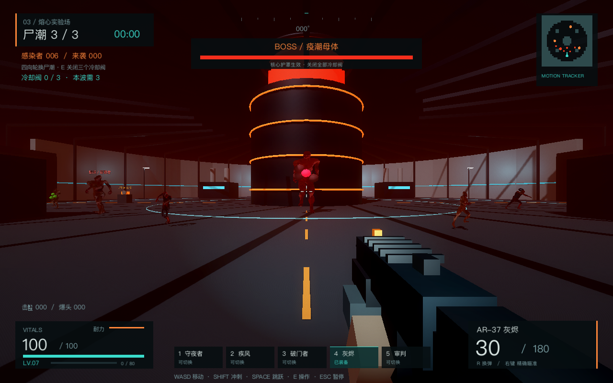
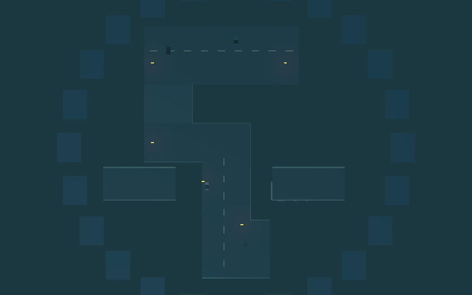
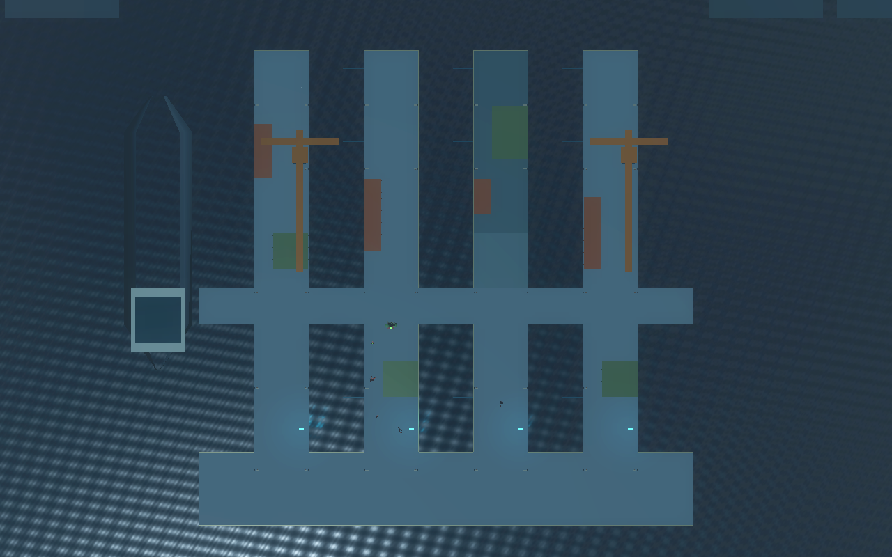
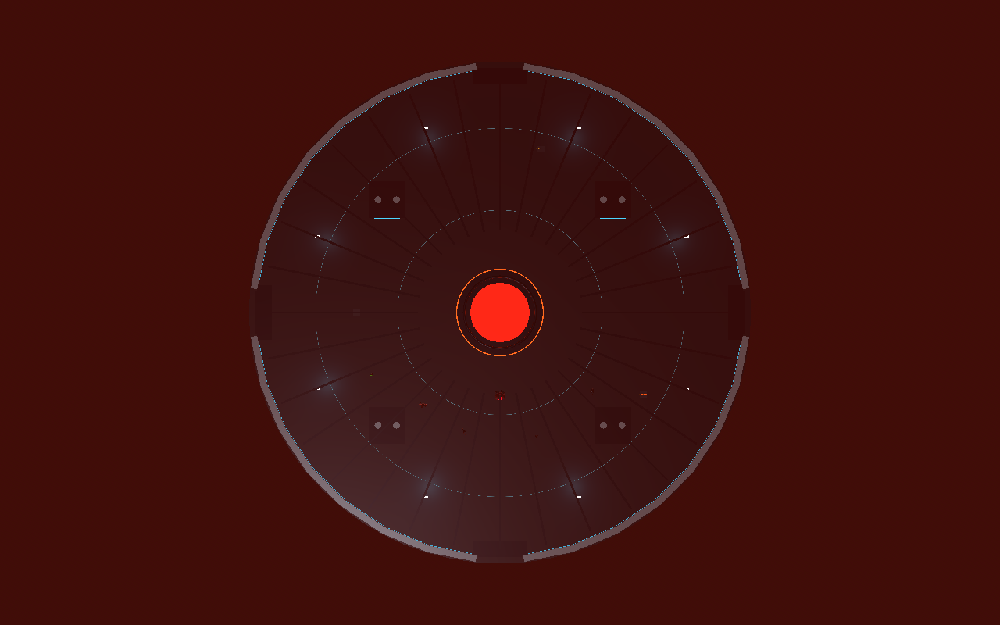
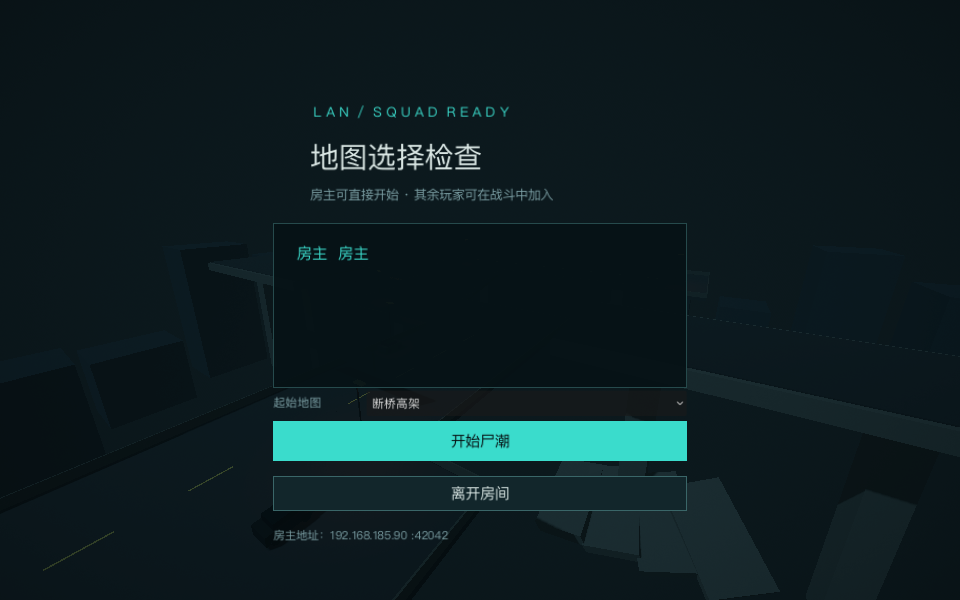
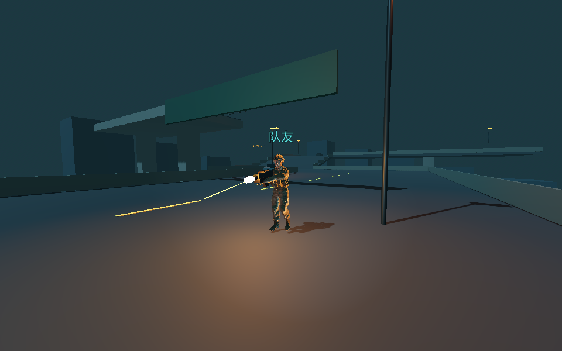
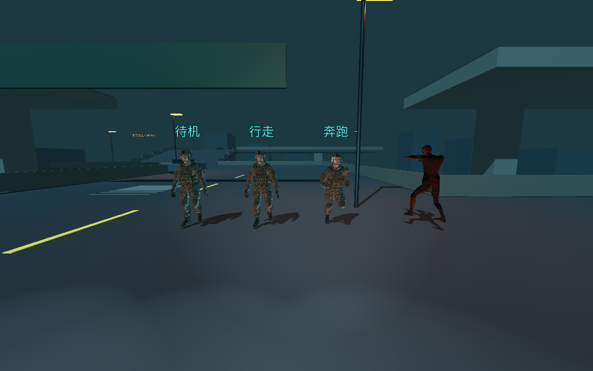

# ASHFALL · 余烬禁区

Godot 4.7 + Rust GDExtension 的 **3D 第一人称末日生存射击游戏，v0.3.4 LAN 选图与表现修复版**。
当前开发分支：`feature/lan-coop`。`main` 为已发布的 v0.2.1 单机稳定版。
完整挑战包括三个固定设计的关卡、九波尸潮、三个关底 Boss，以及成长解锁的五种武器。

## 场景预览

| 断桥高架 | 沉没船坞 | 熔心实验场 |
|---|---|---|
|  |  |  |
|  |  |  |

## Windows 64 位游玩

**下载局域网版：[Windows64 LAN v0.3.4 预发布版](https://github.com/xiejunlei/ashfall-3d/releases/tag/v0.3.4-lan)。**
本地修复版：`dist/ASHFALL-LAN-Windows64-v0.3.4.zip`。完整解压后运行 `ASHFALL-LAN.exe`。
原单机稳定版：[Windows v0.2.1 Release](https://github.com/xiejunlei/ashfall-3d/releases/tag/v0.2.1)。

1. 将 ZIP 完整解压到任意文件夹。
2. 双击 `ASHFALL-LAN.exe`，选择「单人生存」或「局域网合作」。
3. 保留同目录的 `.pck`、Rust `.dll` 和其他随包文件；无需安装 Godot 或 Rust。

运行环境：Windows 10 / 11 64 位，支持 OpenGL 3.3 的显卡，键盘和鼠标。

## 局域网合作

### v0.3.4 起始地图与战斗表现

- 创建房间后，房主可在大厅选择起始地图，默认「断桥高架」。客户端同步所选关卡；重开保留本房间选图，新房间恢复默认。所选地图从自己的第一波开始，之后继续后续关卡。
- 第一关桥墩不再延伸到路面高度，修复俯视图中的矩形亮块和视角变化时的跳动亮线。
- 普通武器使用最长 1.2 米的快速移动曳光，电磁炮和 Boss 冲锋预警保留光束；射程和伤害判定不变。
- 尸体会落到真实碰撞地面，死亡姿态完成后按变形网格底部贴地，适配高架、高低码头、实验场与坡道。血迹沿地面高度和法线铺放。
- 新增桥面几何／闪烁、六类尸体落地、地图选择／重开回归，以及真正房主和客户端的非默认选图测试。

| 房主大厅选图 | 队友射击与短曳光 |
|---|---|
|  |  |

### v0.3.3 射击表现、地面与性能修复

- 队友显示五种武器，骨骼手臂跟随枪握点；同步瞄准俯仰、射击后坐力、枪口闪光与弹道，电磁炮保持青色弹道。
- 客户端本机立即预测弹道，伤害和命中提示仍由房主确认。低帧率下，新闪光与弹道至少显示一个渲染帧。
- 移除高架和码头交叉平台的同高度重叠面，避免深度冲突闪烁；水道改为非金属材质，码头和实验场地面使用更高粗糙度。
- 房主状态回填随 20 Hz 快照更新，战斗动作即时更新；每物理帧共享队友目标数组，弹道复用网格，碎屑限量并关闭微小特效阴影。
- F3 增加 CPU／物理毫秒、绘制调用和特效数量。优化尚未量化两台 Windows 实机的帧率提升。
- 新增射击／地面回归（包含实际武器与射击像素对照），双人流程及四人热加入检查队友开枪和俯仰同步。

### v0.3.2 独立幸存者角色

玩家／队友使用下载的独立士兵模型：迷彩服、战术背心、头盔和军靴，不再复用丧尸身体。保留独立人形骨骼与走／跑动画，增加站立待机；模型优化为 27,896 个三角形，贴图最大 2048px。
来源 [Grab3D Soldier](https://grab3d.com/models/characters/soldier/)，CC0 授权，下载与转换脚本及来源记录均在项目内。



### v0.3.1 怪物显示修复

修复单人和联机场景中怪物身体消失、仅显示配件的问题。骨骼网格使用与实际身高一致的自定义渲染包围盒，并禁用兼容渲染器下不稳定的压缩、自动 LOD／阴影网格导入优化。
新增实际帧图像对照回归：仅切换导入的骨骼身体可见性，防止头盔、标签和碰撞体使检查误通过；六类怪物在单人和 LAN 模式共 12 项检查通过。

- 主菜单「局域网合作」：房间自动发现、创建房间、加入、IP 直连。
- 最多四人，房主开始后可热加入。房主离开时返回大厅。
- 团队共享经验与武器等级，血量、弹药、强化独立；按 **U** 分配个人强化点。
- 倒地有 20 秒救援时间，队友靠近按住 **E** 3 秒可恢复 30% 生命；超时观战、下一波复活。
- 全队失去战斗能力时结算，房主可重开。联机个人菜单不会暂停战场。
- 新队友加载场景期间不参与战斗判定，准备完成后激活；继承当前武器等级和强化点。
- 默认 UDP 游戏端口 **42042**，发现端口 **42043**；房间列表也包含正在战斗的房间。
- 同一台电脑多开可用 `127.0.0.1`；不同电脑使用大厅显示的房主局域网 IP。

详细操作：[LAN 游玩说明](docs/lan-readme.txt)。

### Rust 主导的网络与规则

`rust/src/network.rs` 实现 UDP 发现、ENet 调用、连接状态、类型化协议、压缩、MTU 分包／限量重组和断线处理。
Godot 的 ENet API 反射调用集中在 Rust 引擎适配边界，以兼容当前最小绑定配置；规则模块使用静态 Rust 类型。
`rust/src/coop.rs` 管理独立角色状态、弹药、换弹、射速与动作去重、移动速度／耐力、强化、倒地和救援。
敌人目标选择、团队经验、难度与武器规则通过 Rust 核心结算；Godot 处理物理射线、场景和表现。
`scripts/lan_game.gd` 是场景/UI 同步适配器，负责应用 Rust 网络事件和权威快照。

房主执行战斗与尸潮，客户端执行本地移动预测与快照校正。完整战局同步包含稳定实体 ID、战局编号和快照序号。
射击反馈在本机立即表现，命中以房主结果确认。
Rust 现有 18 项测试，配合严格 Clippy；联机测试使用真正的房主和客户端进程。
运行验证已覆盖本机 macOS 多进程和图形客户端；两台 Windows 电脑之间的局域网通信尚待实机确认。

### v0.2.1 卡关修复

- 第三关气闸增加后方实体封挡，避免击退把怪物推出圆形地板。
- 意外跌落或越界的怪物会保留血量回到有效地面，不凭空消失，也不伪造击杀奖励。
- 出生位置同时检查实际胶囊碰撞和到玩家的可达路径；失败的生成保持待生成配额并重试。
- 存活数量定期与场景中的真实活怪同步，排除已删除或排队删除的对象。
- Boss 未成功生成时保留待生成状态，避免错误跳过关底怪物。
- 共享丧尸皮肤材质，修复快速删除怪物时的渲染材质失效问题。
- 专项测试完成第三关第一波 106 只真实怪物的生成、击杀和第二波衔接。

## 操作

| 操作 | 按键 |
|---|---|
| 移动、转向 | WASD、鼠标 |
| 射击 / 精确瞄准 | 鼠标左键 / 右键 |
| 冲刺 / 跳跃 | Shift / 空格 |
| 换弹 / 手电 | R / F |
| 操作冷却阀 | E |
| 救援队友 / 个人强化 | 按住 E / U |
| 切换武器 | 1–5 或鼠标滚轮 |
| 暂停、鼠标灵敏度 | Esc |
| 性能信息 | F3 |

手枪有无限备用弹药，但仍需换弹。其他武器有弹药限制，可回收感染者掉落的弹药。
每波肃清后恢复部分生命与弹药，12 秒后开始下一波。

## 三个关卡

| 关卡 | 风格与路线 | 关底 Boss |
|---|---|---|
| **断桥高架** | 悬空折线公路：低桥面 4m、上坡到 8m、西侧转弯、上方断裂的另一条立交、桥下城市；空间是弯折长廊 | **断街暴君**：蓄力冲锋、范围砸地、召唤 |
| **沉没船坞** | 真正不可通行的水道分隔四条码头，以中间横桥和后方码头连接；东侧装卸坡道抬高 2.8m；每六只一批，交替从不同码头进入 | **溺潮巨骸**：固定三连线／环形腐蚀、召唤、近距离砸地 |
| **熔心实验场** | 圆形大厅：中央大型实体核心挡住视线，四向气闸轮换进怪，四座冷却设备形成掩体；绕核心转移并操作三处阀门 | **疫潮母体**：固定十字腐蚀、混合技能、半血狂暴；关闭三阀后解除护罩 |

每关三波，第三波出现 Boss。肃清所有敌人后自动进入下一关，**等级、强化与武器保留**。
第九波结束后通关。死亡可重新挑战，最佳击杀与尸潮纪录保存到 Godot 用户数据目录。

实验场每波还需要累计关闭 1／2／3 个冷却阀。靠近控制台按 **E**，雷达会标记未关闭的阀门。
关闭阀门恢复少量生命与弹药；全部关闭后 Boss 护罩解除。高架或码头跌落会扣血并回到附近可通行地面。

### 腐蚀的固定规律

- **普通腐蚀者**：必须看到玩家，锁定一个落点；锁定后不再跟随玩家移动。
- **船坞 Boss**：按“三连线 → 环形”轮换。三连线沿码头方向依次爆发，环形中央和圈间缺口可躲避。
- **实验场 Boss**：固定中心加四向的十字落点，向对角空隙闪避。
- **可读时序**：琥珀色预警和填充倒计时至少 1.6 秒 → 绿色伤害区 → 2.8–3.2 秒后无伤消退。
- 所有腐蚀者共享施法间隔；同屏最多六个腐蚀点，拒绝重叠堆叠，不落在水中或不可通行区域。
- 杀死腐蚀者可中断未爆发的预警。Boss 击败和尸潮肃清后清除对应危险区。
- 地面预警沿坡道倾斜，视觉边界和伤害范围对应；不再每个落点堆叠大字、光柱和爆炸。

## 怪物层级与外观

网络下载的带真实皮肤、血污、法线贴图和骨骼的资产用于所有敌人。

- **感染者**：城市血污人形，胖瘦、色泽、装备与步态有变化。
- **疾行者**：人形与畸变体两种轮廓，速度快、耐久低。
- **屠戮者（精英）**：宽大的畸变怪物，高耐久与重击。
- **装甲感染者（精英）**：头盔、防弹背心与胸部减伤；爆头有效。
- **腐蚀者（精英）**：畸变身体、感染囊，远程制造预警腐蚀区域。
- **Boss**：巨大畸变体，独立名称、感染色泽、身体特征与技能轮换。

Boss 半血狂暴。红圈砸地可离开范围或跳跃；冲锋有提前提示；绿色腐蚀区需要绕开。
头部与 Boss 发光胸腔核心都是弱点。

## 武器与成长

| 等级 | 武器 | 特征 |
|---|---|---|
| 1 | P-09 守夜者 | 半自动手枪、无限备用弹药 |
| 2 | V-45 疾风 | 高射速冲锋枪 |
| 3 | SG-8 破门者 | 10 弹丸霰弹、强击退与重反馈 |
| 5 | AR-37 灰烬 | 全自动突击步枪 |
| 7 | RX-1 审判 | 可穿透四名敌人的电磁炮 |

击杀与弱点击杀获得经验。升级时选择：伤害强化、生命与抗性、机动与换弹。
命中反馈包括枪口闪光、局部光照、后坐力、弹道、弹壳、血雾、击退、命中标记、击杀反馈和短暂命中停顿。
原生骨骼动作包括行走、奔跑、攻击；城市感染者还有受击、死亡、咆哮与不同步态。

## 技术结构

- `rust/src/rules.rs`：不依赖引擎的波次、怪物分层、武器、伤害、经验和强化规则。
- `rust/src/tactics.rs`：确定性腐蚀图案、各关尸潮节拍、阀门目标与护罩规则。
- `rust/src/lib.rs`：`AshfallCore` GDExtension，连接 Godot；含 Rust 尸群分离与移动转向。
- `scripts/main.gd`：关卡流程、生成敌人、腐蚀／冲击预警、死亡与通关。
- `scripts/player.gd`：第一人称输入、射击射线、换弹、镜头与武器展示。
- `scripts/zombie.gd`：Godot 物理、寻路与骨骼动画；规则由 Rust 返回。
- `scripts/level.gd`：三套固定建筑、掩体、地标布局；静态几何按材质合批。
- `scripts/hud.gd`：中文 HUD、雷达、成长选择、菜单和结算。
- `assets/models/`：经过优化、贴图修复和动画重定向的 GLB。
- `tools/`：资产转换与 Windows 交叉编译辅助工具。

## 源码运行与构建

需要 Godot **4.7**、Rust **1.94+**。首次克隆后先构建本机 Rust 扩展，再导入 Godot 项目。

```sh
cargo build --manifest-path rust/Cargo.toml
godot --headless --path . --editor --import --quit
godot --path .
```

macOS 若 Xcode 工具链路径无效，可用本地环境变量指定已安装的 Command Line Tools：

```sh
DEVELOPER_DIR=/Library/Developer/CommandLineTools cargo build --manifest-path rust/Cargo.toml
```

macOS 上用 Zig 0.13 交叉编译 Windows x64：

```sh
rustup target add x86_64-pc-windows-gnu
CARGO_TARGET_X86_64_PC_WINDOWS_GNU_LINKER="$PWD/tools/zig-linker.sh" \
  cargo build --manifest-path rust/Cargo.toml --release --target x86_64-pc-windows-gnu
python3 tools/fetch_windows_template.py
mkdir -p dist/ASHFALL-LAN-Windows64
godot --headless --path . --export-release Windows64-LAN dist/ASHFALL-LAN-Windows64/ASHFALL-LAN.exe
python3 tools/package_windows.py --lan
```

Zig 适配脚本过滤不支持的 GNU 参数，PE `.drectve` 显式导出 `gdext_rust_init`。
Windows 机器上的原生 GNU 构建也可使用同一 Rust target，再通过 Godot 导出预设导出。

## 验证

```sh
cargo test --manifest-path rust/Cargo.toml
cargo clippy --manifest-path rust/Cargo.toml -- -D warnings
godot --headless --path . -- --smoke-test
godot --path . -- --arena-regression
godot --path . -- --visual-review
python3 tools/test_lan.py --four
python3 tools/test_lan.py --scenario
python3 tools/test_lan.py --render
godot --path . -- --lan-visual
godot --path . --script res://tests/render_visibility.gd
godot --path . --script res://tests/render_visibility.gd -- --probe-lan
godot --path . --script res://tests/survivor_visual.gd
godot --path . --script res://tests/combat_visual_regression.gd
godot --path . --script res://tests/highway_surface_regression.gd
godot --path . --script res://tests/corpse_ground_regression.gd
godot --path . --script res://tests/lan_map_regression.gd
python3 tools/test_lan.py --map=2
```

Rust 包含 18 项规则、合作和网络测试。Godot 的 88 项集成检查覆盖实际射线命中、全部武器、换弹、解锁、三关路径连通、成长保留、Boss 技能与狂暴、九波自动流程、死亡重启和通关，还验证关卡地面拓扑差异、真实坡道碰撞与丧尸爬坡、导航高差连续性、冷却阀操作／波次门槛、腐蚀伤害时序／固定落点／限量与防叠加。
第三关另有 15 项专项回归：真实击退、跌落恢复与血量保留、四门六类怪物出生、活怪计数校正、失败出生配额重试，以及第一波 106 只实怪清理后进入第二波。
视觉截图存于 `tests/previews/`，`01/02/03-layout.png` 为俯视布局，`05-acid-warning.png` 和 `06-acid-active.png` 为腐蚀阶段对照。

## 资产来源与许可

详见 `THIRD_PARTY_ASSETS.md`。丧尸来自 OpenGameArt 的两套 **CC0** 资产；作品作者与原始链接随 Windows 包一起提供。
环境、武器、界面、音效和玩法实现为本项目制作。
